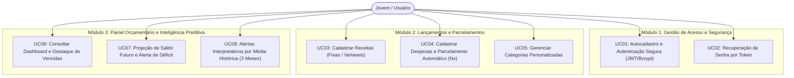
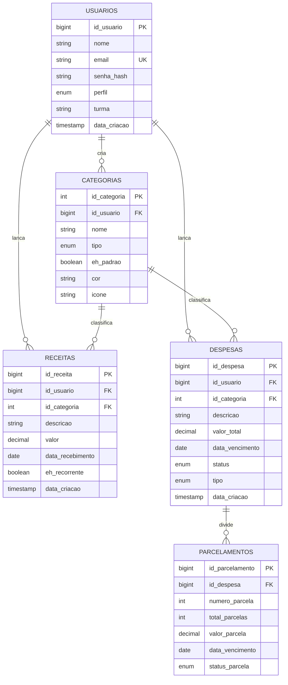

# 📄 Especificação de Software (Spec Final) — FinanSense 2.0

> **Projeto:** FinanSense — Controle Financeiro Pessoal Inteligente  
> **Autora:** Raiany Alexandra Felix do Nascimento  
> **Curso / Turma:** 3º ano do Curso Técnico em Informática Integrado ao Ensino Médio (3º B)  
> **Docente Avaliador:** Prof. Rafael Pitwak  
> **Repositório GitHub:** `https://github.com/rayyafn/finansense2.0`  
> **Sistema Publicado (Vercel):** `https://finansense2-0.vercel.app` (ou link publicado correspondente)  
> **Vídeo Pitch Acadêmico (YouTube):** [Assistir no YouTube](https://youtu.be/iiRMwRVgXCI)  

---

## 1. Objetivo do Sistema

O **FinanSense** é uma aplicação web completa de gestão e inteligência financeira pessoal projetada especificamente para jovens de 18 a 24 anos (pertencentes à Geração Z). O sistema resolve a dificuldade de acompanhamento e a falta de disciplina no controle de orçamentos, indo além de simples tabelas ou registros contábeis convencionais ao transformar dados brutos em **diagnósticos em linguagem natural, projeções preditivas de saldo futuro e alertas preventivos contra endividamento**.

---

## 2. Perfil Demográfico de Usuários (Público-Alvo)

O público-alvo primário é composto por jovens de 18 a 24 anos em fase de transição para a autonomia financeira.

### 2.1 Características Financeiras e Sociais (Evidências de Mercado - CNDL / SPC Brasil / Sebrae)
- **Renda Própria:** 78% dos jovens entrevistados possuem alguma fonte de rendimento próprio (estágio, bolsa, CLT ou freelance).
- **Responsabilidade Familiar:** 65% contribuem financeiramente para as contas de suas residências.
- **Recorrência de Gastos:** 9 em cada 10 jovens relatam ter pelo menos uma despesa mensal fixa (alimentação, transporte, internet/celular).
- **Potencial de Poupança:** 52% possuem algum valor guardado, mas carecem de métodos preditivos.
- **Contradição Tecnológica:** Embora altamente conectados, 47% dos jovens não realizam nenhum controle e 26% dos que controlam ainda utilizam cadernos ou papel. Principais barreiras: não saber como fazer (19%), preguiça (18%) e falta de hábito (18%).

### 2.2 Subgrupos de Usuários Atendidos
1. **Jovem Estudante:** Recebe bolsa, auxílio ou mesada; necessita gerenciar pequenos orçamentos e evitar compras impulsivas com lazer e lanches.
2. **Jovem Trabalhador Formal (CLT / Estagiário):** Possui receita mensal previsível; foca em agendar vencimentos fixos, gerenciar parcelamentos e planejar o saldo livre.
3. **Jovem Freelancer / Informal:** Renda oscilante; necessita entender sua média de custos versus histórico de entradas para não contrair obrigações incompatíveis.
4. **Jovem Arrimo / Co-provedor Familiar:** Compartilha despesas com pais ou parentes; necessita de controle rígido de vencimentos para evitar cortes de serviços essenciais e juros.

---

## 3. Casos de Uso Principais



### Detalhamento dos Casos de Uso:
- **UC01 — Autenticação e Cadastro:** Permite ao jovem criar uma conta com nome, e-mail e senha. As senhas são criptografadas com hash bcrypt (salt rounds 10) e a sessão autenticada por token JWT.
- **UC02 — Recuperação de Senha:** Envio e simulação de token temporário de segurança para redefinição.
- **UC03 — Cadastrar Receitas:** Registro de entradas informando descrição, valor ($> 0$), data e recorrência.
- **UC04 — Cadastrar Despesas e Parcelamentos:** Registro de contas com tipo (fixa, variável, parcelada) e status (`a_pagar`, `paga`). Se parcelada em $N$ vezes, gera automaticamente as $N$ parcelas nos meses subsequentes.
- **UC05 — Gerenciar Categorias:** Permite criar categorias personalizadas associadas ao usuário ou usar as categorias nativas da plataforma.
- **UC06 — Consultar Dashboard:** Exibe saldo disponível em tempo real, contas vencidas em destaque vermelho, compromissos dos próximos 15 dias e gráficos de pizza/distribuição.
- **UC07 — Projeção de Saldo Futuro:** Calcula se o saldo ao fim do mês será positivo ou negativo considerando contas a pagar e receitas previstas. Se $< 0$, emite alerta preventivo de déficit.
- **UC08 — Alertas por Média Histórica:** Calcula a média dos últimos 3 meses por categoria; se o mês corrente exceder a média em 25% a 30%, emite diagnóstico em linguagem natural.

---

## 4. Requisitos Funcionais (RF)

- **RF01:** O sistema deve permitir o autocadastro de novos usuários solicitando nome, e-mail e senha.
- **RF02:** O sistema deve realizar a autenticação de usuários cadastrados mediante validação de e-mail e senha com hash.
- **RF03:** O sistema deve disponibilizar funcionalidade de recuperação e redefinição de senha por token temporário.
- **RF04:** O sistema deve garantir isolamento de dados (*multi-tenant*), onde cada usuário visualiza e manipula estritamente suas próprias informações financeiras.
- **RF05:** O sistema deve permitir o registro de receitas informando descrição, valor ($> 0$), data de recebimento, categoria e recorrência.
- **RF06:** O sistema deve permitir o registro de despesas informando descrição, valor total ($> 0$), data de vencimento, categoria, tipo (fixa, variável ou parcelada) e status (`a_pagar`, `paga`).
- **RF07:** O sistema deve classificar e destacar visualmente em vermelho como "contas vencidas" todas as despesas não quitadas cuja data de vencimento seja anterior à data atual.
- **RF08:** O sistema deve calcular o valor individual de compras parceladas em $N$ vezes e gerar automaticamente os registros das parcelas com vencimentos nos meses subsequentes.
- **RF09:** O sistema deve permitir a alteração e exclusão de receitas, despesas e parcelamentos.
- **RF10:** O sistema deve permitir o gerenciamento (criação, listagem e exclusão) de categorias personalizadas de receitas e despesas.
- **RF11:** O sistema deve calcular e exibir no dashboard o saldo disponível atual ($\text{Receitas Acumuladas} - \text{Despesas Efetivamente Pagas}$).
- **RF12:** O sistema deve consolidar e listar todas as contas a pagar agendadas para a janela dos próximos 15 dias.
- **RF13:** O sistema deve gerar gráficos e indicadores percentuais de gastos acumulados por categoria via Chart.js.
- **RF14:** O sistema deve calcular a média histórica individual de consumo mensal do usuário por categoria com base nos últimos 3 meses.
- **RF15:** O sistema deve comparar o montante gasto no mês vigente em cada categoria com a média histórica individual.
- **RF16:** O sistema deve emitir alertas interpretativos em linguagem natural quando o consumo em uma categoria ultrapassar a média histórica individual em $\ge 25\%$.
- **RF17:** O sistema deve calcular e exibir a estimativa de saldo no final do mês considerando o saldo atual, despesas agendadas e receitas previstas.
- **RF18:** O sistema deve emitir um alerta preventivo de risco de déficit orçamentário caso a projeção de encerramento do mês seja inferior a zero.

---

## 5. Requisitos Não Funcionais (RNF) — Segurança e Desempenho

- **RNF01 (Armazenamento Criptografado de Senhas):** Senhas nunca são salvas em texto puro. Utiliza-se hash bcrypt com salt de 10 rounds no backend.
- **RNF02 (Comunicação Criptografada):** Tráfego sob HTTPS na versão publicada e suporte a conexões seguras.
- **RNF03 (Controle de Acesso e Isolamento):** Endpoints protegidos com JWT; todas as consultas filtram rigorosamente por `id_usuario`.
- **RNF04 (Minimização de Dados):** Armazenamento apenas dos dados essenciais para o controle orçamentário.
- **RNF05 (Validação Obrigatória no Servidor):** Validação de valores, strings, e-mails e regras de negócio no backend antes de qualquer persistência.
- **RNF06 (Proteção contra SQL Injection e XSS):** Utilização estrita de *Prepared Statements* parametrizados (`?`) no driver `mysql2/promise` e sanitização de dados.
- **RNF07 (Tempo de Resposta da Interface):** Carregamento de painéis em menos de 2 segundos.
- **RNF08 (Disponibilidade e Resiliência Híbrida):** Arquitetura com fallback transparente: se o banco de dados remoto estiver offline no ambiente de demonstração, o sistema opera de forma resiliente via LocalStorage/Mock, garantindo disponibilidade contínua sem travar a avaliação.
- **RNF09 (Design Responsivo):** Interface adaptada para desktop, tablet e smartphones via Tailwind CSS.
- **RNF10 (Facilidade de Uso):** Diagnósticos em linguagem clara, botões rápidos de teste e feedback visual imediato.

---

## 6. Modelo de Dados (FinanSense Relacional)

### 6.1 Diagrama Entidade-Relacionamento (DER)



---

## 7. Critérios de Aceite (CA)

- **CA01 — Autenticação e Acesso Seguro:** Usuário entra com e-mail e senha válidos $\rightarrow$ sistema valida hash bcrypt no banco $\rightarrow$ emite JWT e direciona ao Dashboard.
- **CA02 — Registro de Despesa e Agendamento de Parcelas:** Usuário cadastra compra de R$ 600,00 em 6 vezes $\rightarrow$ sistema salva a despesa pai e gera 6 parcelas de R$ 100,00 nos meses subsequentes.
- **CA03 — Destaque de Contas Vencidas:** Despesa não quitada com data anterior a hoje $\rightarrow$ exibida com destaque vermelho e badge "Vencida" no dashboard.
- **CA04 — Alerta Interpretativo por Média Histórica:** Despesa atual em "Lazer" de R$ 260,00 contra média de R$ 200,00 nos últimos 3 meses (aumento de 30%) $\rightarrow$ exibe card de alerta em linguagem natural no topo do dashboard.
- **CA05 — Projeção de Saldo Futuro e Aviso de Déficit:** Contas agendadas até o fim do mês superiores ao saldo atual + receitas $\rightarrow$ projeta saldo negativo e exibe alerta de déficit em vermelho.
- **CA06 — Personalização de Categorias:** Usuário cria categoria personalizada $\rightarrow$ salva associada ao seu `id_usuario` e disponibiliza imediatamente nos formulários.

---

## 8. Decisão de Stack e Arquitetura

1. **Frontend (Interface do Usuário):**
   - **React 18 + Vite:** Interface SPA reativa e componentizada.
   - **Tailwind CSS:** Estilização moderna e layout 100% responsivo.
   - **Lucide React:** Biblioteca de ícones acessíveis.
   - **Chart.js + React-ChartJS-2:** Gráficos interativos de distribuição percentual.
2. **Backend (API REST):**
   - **Node.js (v18+) + Express:** Servidor HTTP RESTful modular.
   - **mysql2/promise:** Conexão com pool assíncrono e suporte nativo a Prepared Statements.
   - **bcryptjs:** Criptografia unidirecional com salt rounds para senhas de usuários.
   - **jsonwebtoken (JWT):** Autenticação stateless com isolamento multi-tenant.
   - **cors & dotenv:** Políticas de segurança HTTP e isolamento de segredos em variáveis de ambiente.
3. **Banco de Dados (Persistência Relacional):**
   - **MySQL 8.0+ / MariaDB 10.4+:** SGBD relacional com chaves estrangeiras, integridade referencial (`ON DELETE CASCADE`) e constraints `CHECK`.
4. **Infraestrutura de Deploy:**
   - **Frontend:** Vercel (distribuição estática de alta disponibilidade).
   - **Backend / API:** Render / Railway ou servidor Node local integrado.

---

## 9. Instalação e Execução (Guia Passo a Passo para o Professor)

Esta seção foi concebida para que qualquer pessoa (especialmente o professor avaliador) possa clonar o repositório em um computador novo e colocar o sistema para funcionar sem precisar de suporte externo.

### 9.1 Ambiente
- **Linguagem e Runtime:** Node.js versão 18.x, 20.x ou superior (testado com Node.js v24.15.0).
- **Gerenciador de Pacotes:** npm (v9+ ou v10+) ou yarn.
- **Servidor Local:** Servidor Express embutido rodando na porta `3001` e servidor Vite na porta `3000`.
- **Comando de Instalação de Dependências:** `npm install`.
- **Sistemas Operacionais Testados e Homologados:** Windows 10/11 (PowerShell/CMD), Linux (Ubuntu/Debian) e macOS.

### 9.2 Banco de Dados
- **SGBD Recomendado:** MySQL 8.0+ ou MariaDB 10.4+ (pode ser via MySQL Server local, XAMPP, WampServer ou Docker).
- **Nome do Banco de Dados a Ser Criado:** `finansense_db`.
- **Caminho do Script SQL no Repositório:** `database/schema.sql`.
- **Como Executar a Importação:**
  - *Opção A (Via Terminal / CLI):*
    ```bash
    mysql -u root -p -e "CREATE DATABASE IF NOT EXISTS finansense_db;"
    mysql -u root -p finansense_db < database/schema.sql
    ```
  - *Opção B (Via phpMyAdmin / DBeaver / Workbench):*
    1. Abra o phpMyAdmin ou Workbench.
    2. Crie o banco de dados `finansense_db` com codificação `utf8mb4_unicode_ci`.
    3. Clique em **Importar** (Import), selecione o arquivo `database/schema.sql` e execute.
- **Dados Iniciais (Seeds):** O script `database/schema.sql` **já insere automaticamente**:
  - As 10 categorias padrão do sistema (4 de receitas e 6 de despesas);
  - 2 usuários de teste com senhas criptografadas em bcrypt;
  - Lançamentos demonstrativos que preenchem as condições de contas vencidas, contas futuras e histórico dos últimos 3 meses para validação imediata dos alertas preditivos.

#### Tabela Descritiva das Tabelas do Banco de Dados:

| Tabela | Campos Principais | Chave Primária | Relacionamentos (Chaves Estrangeiras) |
| :--- | :--- | :--- | :--- |
| **`usuarios`** | `id_usuario`, `nome`, `email`, `senha_hash`, `perfil`, `turma`, `data_criacao` | `id_usuario` | — |
| **`categorias`** | `id_categoria`, `id_usuario`, `nome`, `tipo`, `eh_padrao`, `cor`, `icone` | `id_categoria` | `id_usuario` $\rightarrow$ `usuarios.id_usuario` (ON DELETE CASCADE) |
| **`receitas`** | `id_receita`, `id_usuario`, `id_categoria`, `descricao`, `valor`, `data_recebimento`, `eh_recorrente` | `id_receita` | `id_usuario` $\rightarrow$ `usuarios.id_usuario`<br>`id_categoria` $\rightarrow$ `categorias.id_categoria` |
| **`despesas`** | `id_despesa`, `id_usuario`, `id_categoria`, `descricao`, `valor_total`, `data_vencimento`, `status`, `tipo` | `id_despesa` | `id_usuario` $\rightarrow$ `usuarios.id_usuario`<br>`id_categoria` $\rightarrow$ `categorias.id_categoria` |
| **`parcelamentos`**| `id_parcelamento`, `id_despesa`, `numero_parcela`, `total_parcelas`, `valor_parcela`, `data_vencimento`, `status_parcela` | `id_parcelamento` | `id_despesa` $\rightarrow$ `despesas.id_despesa` (ON DELETE CASCADE) |

---

### 9.3 Variáveis de Ambiente

O repositório contém o arquivo `.env.example`. Para rodar localmente, crie uma cópia com o nome `.env` na raiz do projeto.

```env
# ========================================================
# .env.example - Configurações do FinanSense 2.0
# ========================================================

# Porta e Ambiente do Backend Express
PORT=3001
NODE_ENV=development

# Conexão com o Banco de Dados MySQL
DB_HOST=localhost
DB_PORT=3306
DB_NAME=finansense_db
DB_USER=root
DB_PASS=

# Segredo de Assinatura para Tokens JWT
JWT_SECRET=finansense_jwt_secret_dev_key_exemplo_2026_substituir_em_producao

# URL da API REST consumida pelo Frontend
VITE_API_URL=http://localhost:3001/api
```

#### Explicação de Cada Variável:
- `PORT`: Porta TCP na qual o servidor Node.js/Express vai escutar requisições HTTP (padrão: `3001`).
- `NODE_ENV`: Define o ambiente (`development` ou `production`).
- `DB_HOST`: Endereço do servidor MySQL (`localhost` para máquina local).
- `DB_PORT`: Porta do MySQL (padrão oficial: `3306`).
- `DB_NAME`: Nome do banco de dados relacional (`finansense_db`).
- `DB_USER`: Usuário do banco com permissões de leitura/escrita (ex.: `root`).
- `DB_PASS`: Senha do usuário do banco (em branco no XAMPP padrão, ou a senha configurada no seu MySQL local).
- `JWT_SECRET`: Cadeia de caracteres utilizada como chave criptográfica simétrica para validar e assinar os tokens JWT de login.
- `VITE_API_URL`: URL base dos endpoints da API REST acessada pela aplicação React.

---

### 9.4 Passo a Passo de Instalação e Execução

Siga rigorosamente os 6 passos abaixo no terminal:

```bash
# 1. Clonar o repositório oficial do GitHub
git clone https://github.com/rayyafn/finansense2.0.git

# 2. Entrar na pasta do projeto
cd finansense2.0

# 3. Instalar todas as dependências do projeto (frontend e backend)
npm install

# 4. Criar o banco de dados no MySQL e importar a estrutura com sementes
# (Execute pelo terminal ou importe database/schema.sql pelo phpMyAdmin / MySQL Workbench)
mysql -u root -p -e "CREATE DATABASE IF NOT EXISTS finansense_db;"
mysql -u root -p finansense_db < database/schema.sql

# 5. Criar o arquivo de variáveis de ambiente a partir do exemplo
cp .env.example .env
# (No Windows PowerShell: Copy-Item .env.example .env)
# Edite o arquivo .env se a sua senha do MySQL local não for vazia.

# 6. Iniciar a aplicação completa (Backend Express + Frontend Vite simultaneamente)
npm run dev:all
```

> **Alternativa com comandos separados em dois terminais:**
> - Terminal 1 (Backend API): `npm run server` (rodando em `http://localhost:3001`)
> - Terminal 2 (Frontend Client): `npm run dev` (rodando em `http://localhost:3000`)

**Endereço para Acessar no Navegador:**
Abra o navegador web no endereço: **`http://localhost:3000`**

---

### 9.5 Como Testar o Sistema

#### A. Usuários de Teste Pré-cadastrados (Fictícios):
O script SQL já cria as seguintes credenciais fictícias de teste:

1. **Perfil Estudante / Jovem Autônomo:**
   - **E-mail:** `raiany@finansense.com`
   - **Senha:** `123456`
   - *Finalidade:* Possui todo o histórico financeiro carregado com despesas pagas, contas vencidas e compra parcelada.
2. **Perfil Docente / Avaliador:**
   - **E-mail:** `professor@finansense.com`
   - **Senha:** `teste123`
   - *Finalidade:* Permite ao professor validar o fluxo limpo e o cadastro de novos registros como administrador.

*(Dica: Na tela de login, há botões de 1 clique para preencher automaticamente as contas de teste).*

#### B. Roteiro do Fluxo Principal (Passo a Passo de Avaliação):
1. **Login:** Acesse `http://localhost:3000`, clique em "Raiany (Estudante)" e depois em **Acessar Painel Financeiro**.
2. **Avaliação do Dashboard:**
   - Observe o **Saldo Disponível** em tempo real no topo;
   - Observe o card vermelho em destaque com **Contas Vencidas** (RF07 / CA03);
   - Observe a agenda de **Contas nos Próximos 15 Dias** (RF12);
   - Observe o **Alerta Interpretativo em Linguagem Natural** no topo alertando que os gastos com "Lazer & Entretenimento" estão 30% acima da média dos últimos 3 meses (RF16 / CA04).
3. **Fluxo Completo de Cadastro de Receita (Banco de Dados):**
   - Clique no botão verde **Novo Lançamento** no topo da tela;
   - Selecione a aba **Receita**, informe descrição (ex.: `Bolsa Monitoria`), valor (`R$ 350,00`), categoria e data;
   - Clique em **Salvar Lançamento**. O saldo no dashboard atualizará imediatamente e o registro persistirá na tabela `receitas`.
4. **Fluxo Completo de Compra Parcelada (RF08 / CA02):**
   - Clique em **Novo Lançamento** $\rightarrow$ selecione **Despesa**;
   - Digite a descrição (ex.: `Notebook para Estudos`), valor total (`R$ 1200,00`), marque o tipo **Parcelada**, selecione **6 parcelas** e salve;
   - Vá para a tela de **Lançamentos** no menu lateral e veja a divisão automática em 6 parcelas mensais de R$ 200,00 geradas no banco (`parcelamentos`).
5. **Gerenciamento de Categorias Personalizadas (RF10 / CA06):**
   - Acesse o menu lateral **Categorias**;
   - Crie uma nova categoria personalizada (ex.: "Cursos Online", cor azul, ícone de livro);
   - Ela aparecerá imediatamente disponível nos seletores de cadastro.
6. **Teste de Autocadastro de Novo Usuário (RF01):**
   - Faça logout (ícone da porta no canto superior direito);
   - Clique na aba **Criar Conta**, insira um novo nome, e-mail fictício e senha;
   - O sistema cadastrará o novo usuário no MySQL com hash bcrypt e iniciará uma nova sessão isolada (*multi-tenant*).

#### C. Problemas Conhecidos e Limitações
- **Envio Real de E-mails:** A recuperação de senha utiliza simulação de envio de token temporário diretamente na tela para fins acadêmicos, evitando dependência de provedores SMTP pagos (como SendGrid ou Amazon SES).
- **Modo Nuvem / Demonstração:** Ao acessar o link público na nuvem (Vercel) sem um cluster MySQL remoto atrelado, o frontend ativa automaticamente o fallback inteligente com LocalStorage, permitindo usar 100% dos recursos sem travamentos.

---

## 10. Checklist de Segurança da Apostila (Anexo B)

| Item Verificado | Status | Implementação no FinanSense 2.0 |
| :--- | :---: | :--- |
| **Senhas com Hash Seguro** | ✅ Aprovado | Senhas armazenadas com algoritmo bcrypt e salt rounds 10 (nenhuma senha em texto puro). |
| **Consultas Parametrizadas** | ✅ Aprovado | 100% das operações SQL no backend utilizam Prepared Statements com placeholders (`?`) no `mysql2/promise`. |
| **Sem Credenciais no Git** | ✅ Aprovado | Arquivo `.env` incluído no `.gitignore`. Repositório fornece apenas `.env.example` sem senhas reais. |
| **Isolamento Multi-tenant** | ✅ Aprovado | Todas as buscas e alterações no banco filtram pelo `id_usuario` autenticado via token JWT. |
| **Validação no Backend** | ✅ Aprovado | Validação obrigatória de campos, tipos e valores maiores que zero diretamente no servidor Express. |
| **Comunicação Criptografada** | ✅ Aprovado | Conexões HTTPS na versão publicada e suporte a headers de segurança. |
